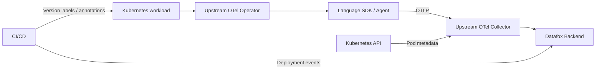

# Datafox Kubernetes Integration — Architecture Map

Status: architecture proposal; D1–D4 product decisions documented, no approved RepoFoundry ADR  
Last reviewed: 2026-11-02

## Purpose and system boundary

This repository will package and verify the Kubernetes-facing integration for Datafox observability across Java, Python, Node.js, .NET and Go. The repository currently contains **design documentation and an engineering harness**, not a deployed Operator, Collector, or application runtime.

Authoritative design and implementation rationale:
- [Unified Tagging Convention](docs/unified-tagging-convention.md) — proposed cross-language and cross-signal field contract
- [Metadata & Release Integration design](docs/architecture.md) — D1–D4 system design
- [Deployment Topology & Isolation Model](docs/deployment-topology-and-isolation.md) — trusted Tenant, standard Region and optional Cell
- [Implementation, rollout safety and verification](docs/implementation-and-verification.md) — planned T01–T44 checks

## Planned component responsibilities

This is a **proposed deployment topology**, not a diagram of running infrastructure.

- **Operator** mutates explicitly opted-in Pods to provide language instrumentation and standard Resource configuration.
- **Language SDK/Agent** owns application identity, including `service.name` and `service.version`.
- **Collector** enriches Kubernetes infrastructure attributes and must not rewrite application identity.
- **CI/CD** reports deployment lifecycle and artifact identity to Datafox Backend.
- **Datafox Backend** owns release/deployment storage and version comparison; it is implemented outside this repository.

The Datafox Java runtime distribution remains in `datafox-java-agent`. This project must not fork upstream OpenTelemetry Operator or Collector.

## Repository map

| Path | Responsibility | State |
| --- | --- | --- |
| `README.md` | Project entrypoint and constraints | Present |
| `docs/unified-tagging-convention.md` | OTel Resource semantics, service identity, instance/IP/DNS attributes | Present; proposal |
| `docs/architecture.md` | Detailed architecture, four design decisions, upstream evidence | Present; proposal |
| `docs/deployment-topology-and-isolation.md` | Tenant, Region, optional Cell deployment model | Present; proposal |
| `docs/implementation-and-verification.md` | Configuration examples, multi-language test matrix, failure and rollback strategy | Present; plan |
| `docs/.engineering/` | RepoFoundry Harness / Spec manifests and locks | Initialized |
| `.repo-foundry/` | Shared Spec Router and canonical project skill | Initialized |
| `.agents/`, `.codex/` | Codex Adapter skills and hooks | Initialized |
| `docs/agent-guides/` | Portable agent and locked Spec reading path | Initialized |
| `docs/DECISIONS.md`, `docs/PLANS.md` | Governed ADR and execution indexes | Scaffold only |
| `charts/`, `configs/`, `tests/` | Planned integration implementation | Not yet implemented |

## Architectural invariants

The four decisions already made in the design review are:

1. Standard `app.kubernetes.io/version` is a recommended input, not a mandatory enterprise label. Explicit SDK configuration and Resource Annotations require per-attribute verification; in particular, Operator-injected `OTEL_SERVICE_NAME` can override `OTEL_RESOURCE_ATTRIBUTES.service.name` in the final SDK Resource.
2. Reuse OpenTelemetry Operator and opt-in Pod Mutation; no Datafox Admission Webhook.
3. Collector adds only infrastructure attributes and does not overwrite `service.name` or `service.version`.
4. CI/CD reports deployment events to the Backend; no Kubernetes Deployment Watcher in v1.

These are **reviewed architectural decisions** in the design discussion. No formal RepoFoundry ADR has been created or accepted automatically.

## Dependency, data and safety boundaries

- Runtime instrumentation and OTLP data follow upstream OpenTelemetry contracts.
- Installation of cluster-scoped resources requires a separately authorized deployment.
- Pod admission fail-open behavior does not ensure an injected Agent can start safely; canary, probes and rollback are mandatory.
- Kubernetes RBAC, SDK resource attributes, and CI/CD event authentication cross different trust boundaries. Arbitrary Pod UID/IP attributes are not authentication; Collector Pod association must be scoped to trusted ingress and Cluster.
- Release events are Datafox API contracts; they are not OpenTelemetry protocol extensions.

## Verification status and remaining gaps

PR #2 previously passed its Harness/Spec CI on the original branch; the reconciled revision requires a fresh check. Cluster installation, Helm rendering, JVM smoke tests, language E2E, safety fault injection, backend event API and cross-version tests have **not run**.

The project still needs validated Operator/Collector/Java Agent version pins, OCI image digests, build and integration commands, CI/CD provider details, approval owners, and production SLOs. Do not invent them or treat this document as operational proof.

For the next implementation step, use the T01–T44 acceptance matrix in [the implementation guide](docs/implementation-and-verification.md); Tag/Topo/Inst/Domain contracts remain proposed and unexecuted.
