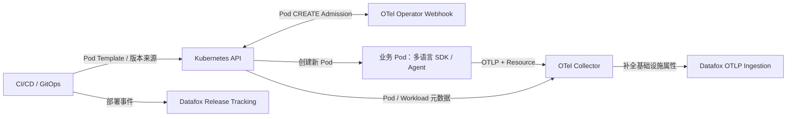

# Datafox Kubernetes — 架构速览

> **状态：Architecture Proposal。** 本文件是面向开发与评审的**架构地图**，不是另一个独立的设计规范。完整的运行时与交付契约以 [docs/architecture.md](docs/architecture.md) 为准；各字段的权威语义以 [统一标签规范](docs/unified-tagging-convention.md) 为准。D1–D4 是产品设计决策编号，尚未注册或批准为正式 RepoFoundry ADR。

## 系统如何工作

Datafox 将三类事实分开：**应用身份**（产生遥测的 SDK Resource）、**运行位置**（Kubernetes/Collector）和**部署事实**（CI/CD Release Event）。它们的来源与生命周期不同，不能通过单个 Label 或版本号相互推断。

- **OpenTelemetry Operator**：仅在 Pod 创建时尝试为显式 Opt-in 工作负载注入 Agent/SDK 配置；Webhook 被调用的范围可以大于实际 Mutation 范围。
- **应用 SDK/Agent**：生成 `service.*`、`deployment.environment.name` 等身份与环境属性；多语言实现必须使用实际导出的 OTLP 验证最终值。
- **Collector**：基于可信 Pod 关联补充 `k8s.*` 等基础设施属性，不改写应用服务身份或代表 CI/CD 宣称发布成功。
- **CI/CD 与 Backend**：保存制品、Release 与单次 Deployment 的事件和状态，不使用“第一条 Span 的时间”推断发布开始。

此图表示**拟实现的结构**，不代表组件已在生产运行。

## 必须保持的架构边界

| 边界 | 约束 |
| --- | --- |
| 服务身份 | 逻辑键为可信 Tenant + `service.namespace` + `service.name`；Helm Release 与 Kubernetes Namespace 不应自动成为长期业务身份 |
| 配置来源 | `app.kubernetes.io/*` 是推荐输入而非强制企业命名。Operator 可能注入 `OTEL_SERVICE_NAME` 并覆盖 `OTEL_RESOURCE_ATTRIBUTES.service.name` 的最终 SDK 结果，必须按实际版本预检 |
| 基础设施身份 | `k8s.pod.uid` / Pod IP 与 `service.instance.id` 不同；UID/IP 不是身份认证或跨租户授权证据 |
| 业务安全 | 不新增 Datafox Admission Webhook；在 CI 阶段拒绝不兼容 `env` / `envFrom` / `valueFrom` 形式；注入故障需要检测与 Canary/回滚 |
| 拓扑 | Tenant 由可信接入确定；`cloud.region` 保留云原生含义；Cell 为可选的 `datafox.unit.id`，不强制所有服务设置 |
| 发布事件 | 同一 Release 可有多次 Deployment；每次尝试使用独立的 `deployment_id`，回滚生成新 Deployment 并关联历史 |
| 外部系统 | Java Instrumentation Distribution 属于 `datafox-java-agent`；Release API/存储属 Datafox Backend；本仓库不 Fork OTel Operator/Collector |

## 文档和代码的职责边界

| 文档或路径 | 负责回答的问题 |
| --- | --- |
| [docs/unified-tagging-convention.md](docs/unified-tagging-convention.md) | 字段叫什么、谁负责、应放在 Resource 还是 Span、如何处理版本和冲突 |
| [docs/architecture.md](docs/architecture.md) | 组件职责、数据流、三类契约、故障域与设计取舍 |
| [docs/deployment-topology-and-isolation.md](docs/deployment-topology-and-isolation.md) | Tenant、Region、Cell 和部署目标的作用域与安全隔离 |
| [docs/implementation-and-verification.md](docs/implementation-and-verification.md) | Operator/Collector 示例、CI 前置检查、Canary、回滚、T01–T44 验收 |
| [docs/index.md](docs/index.md) | 统一文档入口、维护与归属规则、RepoFoundry 治理入口 |
| `.repo-foundry/`、`.agents/`、`.codex/`、`docs/.engineering/` | 已初始化的 Harness、Agent 适配器和 Engineering Specs；非 Kubernetes 产品实现 |
| `docs/DECISIONS.md`、`docs/PLANS.md`、`docs/DESIGN-DOCS.md` | RepoFoundry 受治理工件索引，不替代上述 Proposal，也不自动授予批准状态 |

## 验证状态与后续实施

**已存在**：四份产品设计文档、RepoFoundry Harness 和对应校验工作流。**尚未证实**：Operator/Collector 的实际选定版本和运行配置、Agent 注入镜像、真实 Pod CREATE、跨语言 OTLP E2E、Backend Release API、性能和故障恢复。

首期工程应先锁定版本和负面输入矩阵，再基于 [实施与验证手册](docs/implementation-and-verification.md) 逐项产生执行证据。没有执行证据的用例保持“待验证”；不将 Harness 校验成功报告为 Kubernetes 集成已通过。
